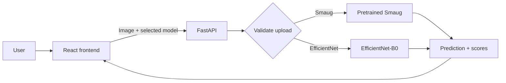

# 🔎 ImageGuard

### Deepfake Image Detection

Analyze an image with **Smaug** or **EfficientNet-B0** and get a REAL/FAKE
prediction through a clean React interface and FastAPI backend.

| 🧠 Detection models | 🖥️ Frontend | ⚙️ Backend |
|---|---|---|
| Smaug + EfficientNet-B0 | React + Vite | FastAPI + PyTorch |

[Frontend guide](frontend/README.md) · [API docs](http://127.0.0.1:8000/docs)

---

## ✨ What it does

- Upload JPG or PNG images up to **10 MB**
- Choose between two image detectors
- View the prediction, confidence, and class scores
- Check API health and explore endpoints with Swagger

## 🏗️ How it works



## 🤖 Models

| Model | Details | Notes |
|---|---|---|
| **Smaug** | Pretrained image detector | Default model; downloaded on first backend startup and cached in `models/smaug/`. |
| **EfficientNet-B0** | Custom two-class model trained on CIFAKE | Resizes RGB images to 224 × 224; weights are expected at `models/deepfake_model.pth`. |

### EfficientNet-B0 training results

| Training accuracy | Validation accuracy | Validation loss |
|:---:|:---:|:---:|
| **99.88%** | **98.87%** | **0.0437** |

These are results from the training and validation run; they do not establish
performance on unseen generators.

## 🚀 Quick start

### 1. Set up and start the backend

From the project root:

```bash
python -m venv venv
```

Activate the environment and install dependencies:

```cmd
venv\Scripts\activate.bat
pip install -r requirements.txt
```

Start the API:

```bash
uvicorn app.main:app --reload
```

> **First run:** The backend downloads Smaug if it is not already cached.

### 2. Start the frontend

In a second terminal:

```bash
cd frontend
npm install
npm run dev
```

Vite opens the frontend in your default browser. It connects to the API at
`http://127.0.0.1:8000`.

## 🔌 API

Interactive API reference: [`http://127.0.0.1:8000/docs`](http://127.0.0.1:8000/docs)

| Method | Endpoint | Purpose |
|---|---|---|
| `GET` | `/` | API information |
| `GET` | `/health` | API and model loading status |
| `POST` | `/predict` | Predict an image |

`POST /predict` accepts a multipart `file` and an optional `model_name`
parameter. Choose `smaug` (default) or `efficientnet`.

Example request:

```bash
curl -X POST "http://127.0.0.1:8000/predict?model_name=smaug" -F "file=@sample.jpg"
```

Example response:

```json
{
  "filename": "sample.jpg",
  "model_used": "smaug",
  "prediction": "FAKE",
  "confidence": 0.987,
  "class_scores": {
    "FAKE": 0.987,
    "REAL": 0.013
  }
}
```

The response values above are illustrative, not an actual prediction.

## 🗂️ Project layout

```text
deep_fake_image_detection/
├── app/                 # FastAPI app, model loading, and prediction
├── frontend/            # React + Vite user interface
├── models/              # EfficientNet weights and cached Smaug files
├── tests/               # API tests
├── requirements.txt
└── README.md
```

## 📝 Logs

Backend logs are written to the terminal running Uvicorn. They include
application and model startup/shutdown, prediction requests and results, and
rejected uploads. Application log messages do not include image contents or
uploaded filenames.

## ⚠️ Limitations

- Performance on unseen AI generators, edited images, and real-world images
  must be evaluated separately.
- Detector confidence scores are not calibrated probabilities and should not
  be interpreted as proof of authenticity.
